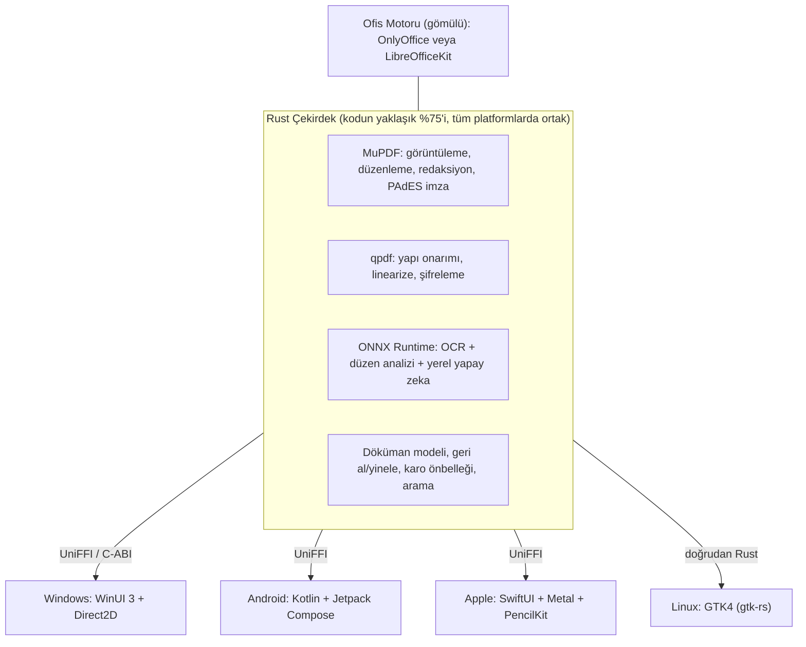
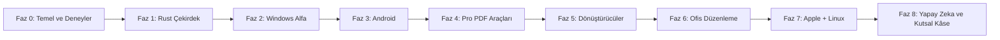
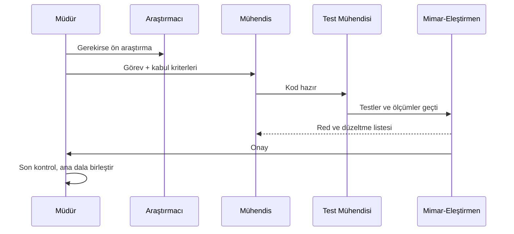

# 🗺️ Proje Yol Haritası: Açık Kaynak, Ücretsiz, Offline Ofis + PDF Paketi

> Çalışma adı: **"Proje Kalem"** (isim sonra belirlenecek)
> Hedef: Adobe Acrobat Pro + WPS Office Pro'nun ücretli özelliklerinin hepsini **ücretsiz, reklamsız, offline ve açık kaynak (AGPLv3)** olarak sunmak. Platformlar: Windows, Android, macOS, iOS/iPadOS, Linux.

---

## 1. Bizi ne farklı kılacak? (Neden kazanabiliriz)

Rakip analizinde kullanıcıların en çok şikâyet ettiği konular ve bizim karşılığımız:

| Kullanıcı şikâyeti | Rakip | Bizim cevabımız |
|---|---|---|
| Abonelik tuzağı, iptal cezası | Adobe ($19.99/ay) | Sonsuza kadar ücretsiz, AGPL lisansı sayesinde geri alınamaz |
| Reklam, açılır pencere, filigran | WPS, Smallpdf | Sıfır reklam, sıfır filigran |
| Dosyaları buluta yükleme zorunluluğu | Smallpdf, iLovePDF | %100 cihazda işleme, telemetri yok |
| Şişkin yazılım, arka plan servisleri | Adobe | Hafif, hızlı açılan yerel uygulama |
| Kapalı kaynağa güvensizlik | PDFgear (bugün ücretsiz ama yarını belli değil) | Kodu herkes denetleyebilir |
| Kötü PDF → Word dönüşümü | Hepsi | Yapay zeka tabanlı sayfa düzeni analizi (Docling) |

> [!IMPORTANT]
> En yakın rakibimiz **PDFgear** (ücretsiz ama kapalı kaynak) ve **Stirling-PDF** (açık kaynak ama sunucu tabanlı, gerçek bir editör değil). Bu ikisinin boşluğu tam olarak bizim konumumuz.

---

## 2. Teknoloji Kararları (Müdür Kararları + Gerekçeler)

### 2.1 Lisans: AGPLv3 ✅
AGPL seçimi bize en güçlü açık kaynak motorları **ücretsiz** kullanma hakkı veriyor: **MuPDF** ve **OnlyOffice**. Kapalı kaynak olsaydık bu motorlar için yılda 10.000–50.000 $ ödememiz gerekirdi.

### 2.2 Mimari: Rust Çekirdek + Her Platformda Yerel Arayüz

**Neden Flutter / React Native / Tauri değil?** (Sorguladım, elendi)
- **Tauri / React Native:** 1000 sayfalık PDF'te akıcı yakınlaştırma ve kalem gecikmesi açısından elendi. RN'in Linux desteği de yok.
- **Flutter:** Güçlü bir aday ama Apple Pencil / PencilKit ve Windows Ink'e doğal erişimi yok. "Dünyanın en iyisi" hedefinde kalem deneyimi tavanımızı düşürür.
- **Kotlin/Compose Multiplatform:** Masaüstünde JVM paketlemek gerekiyor (+50 MB, yavaş açılış).
- PDF Expert, Xodo, Foxit, Drawboard gibi sektör liderlerinin hepsi bu modeli kullanıyor: **yerel C/C++ çekirdek + yerel arayüz.**

> [!NOTE]
> Yerel arayüzün dezavantajı 3–4 ayrı arayüz kodu yazmak. Ancak kodu yapay zeka ajanları yazacağı için bu maliyet, insan ekibine göre çok daha düşük. Kural: **Arayüzler "ince" olacak.** Tüm mantık Rust çekirdekte duracak, arayüz sadece çizim yapıp olayları iletecek.

### 2.3 Alt Sistem Seçimleri

| Alt sistem | Birincil seçim | Yedek | Lisans |
|---|---|---|---|
| PDF motoru | **MuPDF** (Rust bağlamaları) | PDFium | AGPL / BSD |
| Yapısal işlemler | **qpdf** | lopdf (Rust) | Apache 2.0 |
| OCR | Apple Vision / ML Kit / Windows OCR (0 MB, mükemmel Türkçe) | **RapidOCR (PP-OCRv5)**: her yerde çalışır | Apache 2.0 |
| Sıkıştırma | MuPDF + qpdf + jbig2enc + mozjpeg | Ghostscript (AGPL, kullanılabilir) | Apache/BSD |
| PDF → Word/Excel | **Docling düzen modeli (ONNX)** + kendi OOXML yazıcımız | TableFormer (tablolar) | MIT/Apache |
| Office → PDF | Ofis motorunun kendi dönüştürücüsü (x2t / LOK) | Apple WebKit | AGPL/MPL |
| Ofis düzenleme | **Karar Faz 0'daki deneyle verilecek** (aşağıda) | | |
| Yerel yapay zeka | llama.cpp + Gemma 3 1B / Qwen 2.5 1.5B + yerel RAG | | MIT/Apache |

---

## 3. ⚠️ Sorgulayıcı Müdür Uyarıları (Dürüst Riskler)

> [!WARNING]
> **Risk 1: Ofis paketini sıfırdan yazmak imkânsız.** OOXML standardı 7.000+ sayfa. WPS bunu yüzlerce mühendisle 15 yılda yaptı. **Kararım:** Ofis düzenleme motorunu yazmıyoruz, **gömüyoruz.** Adaylar:
> - **OnlyOffice** (AGPL): En iyi MS Office uyumluluğu, editörleri JS tabanlı (WebView içinde çalışır). *Dikkat: AGPL'ye ek olarak logolarının korunmasını isteyen bir maddeleri var, hukuki olarak doğrulanacak.*
> - **LibreOfficeKit** (MPL): Collabora mobilde çalıştığını kanıtladı ama +170–330 MB ve dokunmatik deneyimi zayıf.
> - **Univer** (Apache): Hafif ve modern ama Docs/Slides tarafı henüz olgun değil.

> [!WARNING]
> **Risk 2: AGPL + Apple App Store çatışması.** GPL/AGPL lisansı ile App Store kullanım şartları arasında bilinen bir çatışma var (VLC 2011'de bu yüzden mağazadan kaldırılmıştı). MuPDF'in telif sahibi Artifex itiraz ederse iOS sürümü kaldırılabilir. **Önlem:** iOS'a geçmeden önce Artifex'e yazılı olarak danışmak. Plan B: iOS'ta PDFium kullanmak (çekirdekte motor soyutlama katmanı bu yüzden zorunlu).

> [!WARNING]
> **Risk 3: Kodun tamamını yapay zekanın yazması.** Ajanlar hızlı kod üretir ama "çalışıyor gibi görünen" hatalı kod da üretir. **Önlem:** Hiçbir kod, bağımsız bir inceleme ajanı + otomatik testler + performans ölçümü olmadan ana dala girmez (bkz. Bölüm 5).

> [!CAUTION]
> **Risk 4: Mac gereksinimi.** iOS/macOS uygulaması derlemek ve test etmek için Mac ve Apple Developer hesabı (99 $/yıl) gerekiyor. Proje açık kaynak olduğu için GitHub Actions'ın macOS sunucuları ücretsiz. Bu derlemeyi çözer ama gerçek cihazda test için bir Mac/iPad yine de lazım olacak.

> [!NOTE]
> **Risk 5: "Kutsal Kâse" özellikleri.** PDF içinde paragraf akışlı metin düzenleme ve dinamik XFA formları, Adobe'nin bile zorlandığı alanlar. Bunlar sona bırakılacak; ilk sürümde nesne düzeyinde metin düzenleme olacak.

---

## 4. Yol Haritası (Fazlar)

Süre sınırı koymuyoruz. Ancak her fazın **ölçülebilir bir geçiş kapısı** var: kapı geçilmeden sonraki faza başlanmaz.

### Faz 0: Temel ve Deneyler (Spike)
- Monorepo, CI/CD (GitHub Actions: Windows, Linux, macOS, Android derlemeleri), `AGENTS.md` kuralları, mimari karar kayıtları (ADR).
- **Test korpusu:** pdf.js test seti, Isartor (PDF/A), bozuk/şifreli/1000+ sayfalık PDF'ler, Türkçe taranmış belgeler, karmaşık DOCX/XLSX/PPTX dosyaları.
- **Deney 1:** Rust + MuPDF ile Windows'ta 1000 sayfalık PDF'i karo karo çizdirmek (WinUI 3 + Direct2D).
- **Deney 2:** Ofis motoru yarışması: OnlyOffice vs LibreOfficeKit vs Univer (uyumluluk, boyut, mobil deneyim, lisans).
- **Deney 3:** Rust ↔ Kotlin (UniFFI) Android'de aynı çekirdek.
- 🚪 **Kapı:** 1000 sayfalık PDF'te ilk sayfa < 300 ms, 60+ fps yakınlaştırma, ofis motoru kararı ADR olarak yazılmış.

### Faz 1: Rust Çekirdek ("Motor")
- Motor soyutlama katmanı (MuPDF / PDFium değiştirilebilir), döküman modeli, karo önbelleği, metin çıkarma ve arama, geri al/yinele, açıklama (annotation) sistemi, sayfa işlemleri (birleştir, böl, döndür, sırala, sil, kırp), şifreleme.
- CLI aracı: tüm özellikler önce komut satırından test edilebilir olacak.
- 🚪 **Kapı:** %90+ test kapsamı, korpustaki tüm dosyalar çökmeden açılıyor, fuzzing ile 24 saat çökme yok.

### Faz 2: Windows Alfa (İlk Kullanıcıya Açılış) — [✅ TAMAMLANDI - v0.1.0-alpha]
- Okuyucu + açıklama + sayfa düzenleyici + sekmeler + karanlık mod + dosya ilişkilendirme + Türkçe/İngilizce arayüz.
- 🚪 **Kapı:** Soğuk açılış < 1 sn (Gerçekleşen: 998 ms), gerçek kullanıcı testleri tamamlandı, GitHub'da `v0.1.0-alpha` sürümü ve bağımsız taşınabilir ZIP paketi (`dist/RbdOfis-v0.1.0-alpha-win-x64.zip`) yayınlandı.

### Faz 3: Android — [✅ TAMAMLANDI - v0.1.0-alpha APK]
- **Track 3A:** Rust Çekirdek Android NDK / JNI FFI Köprüsü (`rbd-ffi` JNI C-ABI, DirectByteBuffer sıfır kopyalama, ART VM panik izolasyonu).
- **Track 3B:** Android Proje Mimarisi (`apps/android`: Kotlin, Jetpack Compose, Material 3, Navigation, MVVM).
- **Track 3C:** Stylus & Kalem Desteği (`InkAnnotationCanvas`: S-Pen ve parmak ayrımı, pürüzsüz Quadratic Bézier eğrileri, çok renkli mürekkep/fosforlu kalem, vektörel silgi, çok seviyeli Geri Al/Yinele).
- **Track 3D:** Çevrimdışı Belge Tarayıcı (`DocumentScannerScreen`: CameraX canlı vizörü, ITU-R BT.601 gri tonlama ve Otsu binarizasyon ile keskin siyah-beyaz belge tarama, doğrudan A4 PDF üretimi).
- **Track 3E:** Güvenlik ve Gizlilik (ADR-0003: Sıfır telemetri, sıfır internet `INTERNET` izni yok, kapalı kaynak Google Play Services/ML Kit yok, 91 anahtarlı 1:1 TR/EN dil simetrisi).
- 🚪 **Kapı:** 22/22 Android birim testi başarılı, bağımsız mimar onayı tamamlandı, `dist/android/rbd-ofis-v0.1.0-alpha.apk` (19.5 MB) üretildi.

### Faz 4: Pro PDF Araçları (Adobe'un paralı özellikleri) — [Sıradaki Faz]
OCR (aranabilir PDF), akıllı PDF sıkıştırma, **gerçek** redaksiyon (kalıcı piksel ve içerik sansürleme), dijital imza (PAdES), form oluşturma ve doldurma, belge karşılaştırma, filigran, sayfa numarası/Bates, PDF/A, toplu işlem (batch), hazır iş akışları.

### Faz 5: Dönüştürücüler
PDF ↔ Word/Excel/PowerPoint, PDF ↔ resim, HTML/Markdown → PDF, EPUB.
- 🚪 **Kapı:** Kendi doğruluk ölçütümüzle (görsel fark + yapı skoru) Adobe çıktısıyla karşılaştırmalı test.

### Faz 6: Ofis Düzenleme (WPS seviyesi)
Faz 0'da seçilen motorun Windows ve Android'e gömülmesi, PDF tarafıyla tek uygulamada birleştirme.

### Faz 7: Apple (macOS, iOS, iPadOS) + Linux
SwiftUI + Metal + PencilKit, GTK4. *Önkoşul: Artifex lisans görüşmesi.*

### Faz 8: Yapay Zeka ve "Kutsal Kâse"
Yerel belge sohbeti ve özetleme (internet yok), paragraf akışlı PDF metin düzenleme, isteğe bağlı kendi bulutunla senkronizasyon (WebDAV / Google Drive / OneDrive).

---

## 5. Orkestrasyon: Yapay Zeka Ekibi Nasıl Çalışacak?

**Müdür (ben):** Kararlar, görev dağıtımı, son onay. **Tüm alt ajanlar: Gemini 3.8 Flash.**

| Rol | Sorumluluk |
|---|---|
| 🏗️ **Mimar-Eleştirmen** | Her tasarımı ve kodu bağımsız olarak inceler, "şeytanın avukatlığını" yapar, onaylamadan kod birleşmez |
| ⚙️ **Çekirdek Mühendisi** | Rust çekirdek, MuPDF/qpdf entegrasyonu, FFI |
| 📱 **Platform Mühendisi** | WinUI / Android / Apple / Linux arayüzleri (platform başına ayrı çağrılır) |
| 🧪 **Test ve Kalite Mühendisi** | Testler, korpus, performans ölçümleri, fuzzing |
| 🔍 **Araştırmacı** | Kütüphane, lisans ve teknik araştırma |

**Değişmez kurallar:**
1. Her görevin yazılı, ölçülebilir kabul kriteri olur.
2. Kodu yazan ajan kendi kodunu onaylayamaz.
3. Testi olmayan kod, kod sayılmaz.
4. Büyük kararlar ADR (mimari karar kaydı) olarak belgelenir. "Neden?" sorusunun cevabı her zaman yazılı olur.
5. Performans gerilemesi = hata.

---

## 6. Senden Beklenen Kararlar

1. **Mac / iPad'in var mı?** (Apple fazının sırasını ve gerçekçiliğini belirler)
2. **Platform sırası:** Windows → Android → Apple önerim uygun mu? (iPad, PDF açıklama pazarının kalbi. Mac'in varsa Apple'ı öne alabiliriz.)
3. **Uygulamanın adı** ve bir **GitHub hesabı** (açık kaynak repo + ücretsiz CI için).
4. Bu planı onaylıyor musun? Onaylarsan **Faz 0**'ı başlatırım.
