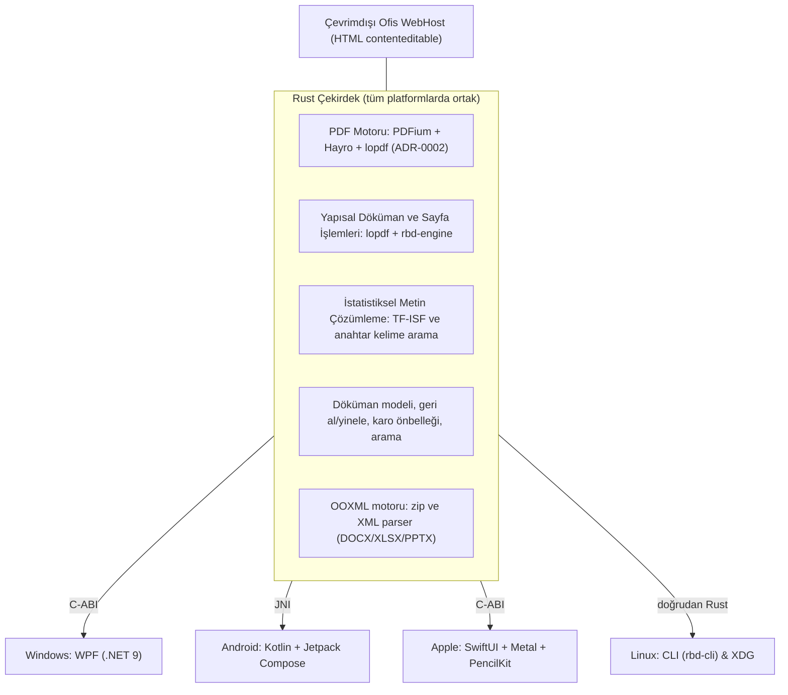

# 🗺️ Proje Yol Haritası: Açık Kaynak, Ücretsiz, Offline Ofis + PDF Paketi

> **RBD OFİS**: Çevrimdışı (offline), açık kaynak (AGPL-3.0), reklamsız, ücretsiz PDF ve hafif ofis dökümanı paketi.  
> Desteklenen platformlar: Windows, Android, macOS, iOS/iPadOS, Linux.

---

## 1. Proje Hedefleri ve İlkeleri

| Konu | Yaygın Sektör Sorunları | RBD OFİS İlkeleri |
|---|---|---|
| **Lisans & Maliyet** | Pahalı abonelikler, kapalı kaynak bağımlılığı | AGPL-3.0 lisansı ile kalıcı olarak açık kaynak ve ücretsiz |
| **Kullanıcı Deneyimi** | Reklamlar, açılır pencereler, zorunlu filigranlar | Sıfır reklam, sıfır filigran, dikkat dağıtmayan arayüz |
| **Gizlilik & Ağ** | Dosyaların sunuculara yüklenme zorunluluğu | %100 çevrimdışı, sıfır telemetri, sıfır harici ağ erişimi |
| **Performans & Boyut** | Ağır arka plan servisleri, şişkin paket boyutları | İnce platform kabuğu, optimize Rust çekirdeği |
| **Dürüst Kapsam** | Gerçek dışı pazarlama vaatleri | Belgelenmiş mimari, sınırlamaların ve yeteneklerin dürüst sunumu |

---

## 2. Teknoloji Kararları

### 2.1 Lisans: AGPL-3.0 ✅
AGPL-3.0-or-later lisansı projenin kalıcı olarak açık kaynak kalmasını teminat altına alır. Çekirdek PDF motoru olarak **PDFium** (Chromium 8125, BSD-3-Clause) ve saf Rust **Hayro + lopdf** (Apache-2.0 / MIT) soyutlama katmanı (`rbd-engine`) üzerinden çalışır (ADR-0002).

### 2.2 Mimari: Rust Çekirdek + Her Platformda Yerel İnce Arayüz

- **Arayüzler incedir:** İş mantığı platform arayüzlerine değil, Rust çekirdeğine (`core/`) yazılır. Arayüzler yalnızca çizim, girdi ve işletim sistemi entegrasyonu sağlar.
- **Windows Arayüzü:** **WPF (.NET 9, C#)**. WinUI 3 yerine kararlılık, bağımsız taşınabilir dağıtım ve düşük sistem ek yükü nedeniyle WPF tercih edilmiştir.
- **Android Arayüzü:** Modern Kotlin ve Jetpack Compose (Material 3).
- **Apple Arayüzü:** SwiftUI, Metal donanım ivmeli karo çizimi ve iPadOS PencilKit.
- **Linux Arayüzü:** `rbd-cli` komut satırı aracı ve XDG masaüstü entegrasyonu.

### 2.3 Alt Sistem Seçimleri

| Alt Sistem | Birincil Seçim | Alternatif / Yedek | Lisans | Gerçekleşen Durum |
|---|---|---|---|---|
| **PDF Motoru** | **PDFium** (Chromium 8125) | **Hayro** (saf Rust) | BSD-3-Clause / Apache-2.0 | Aktif (ADR-0002) |
| **Yapısal İşlemler** | **lopdf** + **rbd-engine** | - | MIT | Aktif (sayfa birleştirme, bölme, döndürme, silme) |
| **OCR** | **Planlandı (henüz uygulanmadı)** | Tesseract / RapidOCR | - | Yapılacaklar listesinde |
| **Sıkıştırma & Pro** | **lopdf** | - | MIT | Aktif (öksüz nesne budama, FlateDecode, filigran, Bates) |
| **Dönüştürücüler** | **image** + **lopdf** | - | MIT / Apache-2.0 | Aktif (PDF-resim, resim-PDF, Markdown-PDF) |
| **Ofis Düzenleme** | **Hafif HTML contenteditable + Saf Rust OOXML** | - | MIT / Açık Kaynak | Aktif (ADR-0004 revize; ONLYOFFICE veya WPS seviyesi değil) |
| **Yapay Zeka** | **İstatistiksel Doğal Dil İşleme (TF-ISF)** | - | MIT / Saf Rust | Aktif (LLM/llama.cpp/RAG değil; hafif özet ve kelime arama) |

---

## 3. Dürüst Riskler ve Mimari Notlar

> [!NOTE]
> **Ofis Düzenleme Gerçeği (ADR-0004):** OOXML standardının büyüklüğü ve ONLYOFFICE bileşenlerinin aşırı paket boyutu (+65 MB üstü), mobil kaynak tüketimi ve ek lisans yükümlülükleri nedeniyle ONLYOFFICE gömülmemiştir. Bunun yerine platformların yerel WebView bileşenlerinde çalışan, sıfır ağ erişimli hafif HTML `contenteditable` editörü ile çekirdekte saf Rust OOXML (`zip` + XML ayrıştırma) metin çıkarma ve DOCX oluşturma yapısı uygulanmıştır. WPS Office seviyesinde devasa bir ofis paketi iddiası yoktur.

> [!NOTE]
> **PDF Motoru Seçimi (ADR-0002):** MuPDF derleme araç takımı kısıtları (`mupdf-sys` Visual Studio 2019 bağımlılığı) ve mağaza lisans riskleri nedeniyle, birincil motor olarak C++ PDFium ve saf Rust referans motor olarak Hayro benimsenmiştir.

> [!NOTE]
> **Yapay Zeka ve Metin Analitiği Gerçeği:** Uygulamada ağır üretken yapay zeka modelleri (LLM, llama.cpp, sinir ağı tabanlı RAG) yer almamaktadır. Bunun yerine tamamen cihaz üzerinde, sıfır ek bellek yüküyle çalışan istatistiksel doğal dil işleme (TF-ISF cümle skorlama ve anahtar sözcük tabanlı soru-cevap) kullanılmıştır.

> [!NOTE]
> **PDF Reflow Türkçe Karakter Desteği:** PDF reflow ve paragraf değiştirme işlemlerinde tüm Türkçe karakterler (`ı, ş, ğ, İ, Ş, Ğ, ç, ö, ü, Ç, Ö, Ü`), Helvetica Type 1 fontuna eklenen `/Differences` ve `/ToUnicode` CMap kodlama eşlemesiyle ASCII fallback olmaksızın tam olarak desteklenmektedir. Harici font gömülmediği için Kiril/Arapça/CJK alfabeleri reflow için henüz desteklenmemektedir.

---

## 4. Yol Haritası ve Faz Durumları

```mermaid
flowchart LR
    F0["Faz 0: Temel ve Deneyler ✅"] --> F1["Faz 1: Rust Çekirdek ✅"]
    F1 --> F2["Faz 2: Windows Alfa (WPF) ✅"]
    F2 --> F3["Faz 3: Android ✅"]
    F3 --> F4["Faz 4: Pro PDF Araçları ✅"]
    F4 --> F5["Faz 5: Dönüştürücüler ✅"]
    F5 --> F6["Faz 6: Ofis Düzenleme (Hafif HTML + OOXML) ✅"]
    F6 --> F7["Faz 7: Apple + Linux ✅"]
    F7 --> F8["Faz 8: İstatistiksel Çözümleme ve Reflow ✅"]
```

### Faz 0: Temel ve Deneyler — [✅ TAMAMLANDI]
- Monorepo yapısı, CI/CD iş akışları, `AGENTS.md` anayasası, mimari karar kayıtları (`docs/adr`).
- PDF motoru değerlendirmesi: PDFium ve Hayro motorları `rbd-engine` soyutlama katmanında doğrulandı (ADR-0002).

### Faz 1: Rust Çekirdek ("Motor") — [✅ TAMAMLANDI]
- `rbd-engine` motor soyutlama katmanı, döküman modeli, karo önbelleği (`lru`), metin çıkarma ve arama, geri al/yinele, açıklama sistemi, sayfa işlemleri.
- `rbd-cli` komut satırı aracı ile test edilebilirlik.

### Faz 2: Windows Alfa (İlk Masaüstü Sürümü) — [✅ TAMAMLANDI - v0.1.0-alpha]
- Windows arayüzü **WPF (.NET 9, C#)** ile Direct2D/WriteableBitmap karo çizimi.
- Okuyucu, sayfa organizatörü, sekmeli döküman yönetimi, karanlık tema, dosya ilişkilendirme, TR/EN tam yerelleştirme.

### Faz 3: Android — [✅ TAMAMLANDI - v0.1.0-alpha APK]
- Kotlin + Jetpack Compose + Material 3 mobil mimarisi.
- Stylus & dokunmatik çizim tuvali (`InkAnnotationCanvas`), CameraX tabanlı çevrimdışı belge tarayıcı.
- Sıfır telemetri, `INTERNET` izni yok, kapalı kaynak bağımlılık yok (ADR-0003).

### Faz 4: Pro PDF Araçları — [✅ TAMAMLANDI - v0.2.0-alpha]
- ISO 32000 uyumlu kalıcı redaksiyon (content stream düzeyinde imha).
- PDF sıkıştırma (öksüz nesne temizliği, Flate sıkıştırma), filigran, Bates damgalama, form alanları (AcroForms) okuma ve düzleştirme.
- Windows WPF ve Android Material 3 arayüz entegrasyonu.

### Faz 5: Dönüştürücüler — [✅ TAMAMLANDI - v0.3.0-alpha]
- PDF → Resim (PNG/JPEG, DPI ölçekleme), Resim → PDF (A4/Letter/FitImage), Markdown → PDF dönüştürme.
- C-ABI ve Android JNI köprüleri, kullanıcı arayüz sihirbazları.

### Faz 6: Ofis Düzenleme (Hafif HTML Düzenleyici + Saf Rust OOXML) — [✅ TAMAMLANDI - v0.4.0-alpha]
- Saf Rust `zip` ve XML parser tabanlı DOCX, XLSX, PPTX metin çıkarma ve döküman denetleme (`core/crates/rbd-engine/src/ooxml.rs`), temel DOCX üretimi (`create_simple_docx`).
- Windows WebView2 ve Android WebView üzerinde çalışan çevrimdışı, sıfır ağ erişimli (`https://rbd-office.local/`) hafif HTML WYSIWYG düzenleyici kabuğu.
- Lisans ve yayın güvenliği: Üçüncü taraf kapalı veya logo zorunlu kodlar (ONLYOFFICE vb.) elenmiş; bağımsız, temiz açık kaynak mimari uygulanmıştır.

### Faz 7: Apple (macOS, iOS, iPadOS) + Linux — [✅ TAMAMLANDI - v0.5.0-alpha]
- `rbd-ffi` C başlığı ve `apps/apple` Swift Package Manager konfigürasyonu (macOS 13+, iOS 16+).
- SwiftUI ve PencilKit arayüzü; CoreGraphics/Metal karo çizimi; `OfficeHostView` WKWebView çevrimdışı kabuğu.
- Linux için `rbd-cli` komut satırı aracı ve XDG masaüstü entegrasyonu.

### Faz 8: İstatistiksel Çözümleme ve Metin Akışı (Reflow) — [✅ TAMAMLANDI - v1.0.0]
- Çevrimdışı istatistiksel doğal dil işleme motoru (`core/crates/rbd-engine/src/ai.rs`): TF-ISF cümle skorlama, stop words filtreleme, anahtar sözcük tabanlı soru-cevap ve metin analitiği (LLM veya RAG gerektirmez).
- Paragraf akışlı PDF metin reflow ve paragraf değiştirme (`reflow.rs`).
- Windows ve Android mobil arayüz entegrasyonları.

---

## 5. Bilinen Sınırlamalar ve Yapılacaklar (Known Limitations & To-Do)

1. **OCR Henüz Uygulanmadı:** Belge tarama mevcuttur ancak optik karakter tanıma (OCR) özelliği henüz uygulanmamıştır; çevrimdışı bir OCR motorunun (ör. Tesseract/RapidOCR) entegrasyonu planlanmaktadır.
2. **Ofis Yetenekleri Sınırı:** Ofis düzenleyici WPS Office veya Microsoft Office seviyesinde tam bir ofis paketi değildir; hafif HTML tabanlı zengin metin düzenleme, saf Rust OOXML metin çıkarma ve temel DOCX dosyası üretimi ile sınırlıdır.
3. **Yapay Zeka Kapsamı:** Ağır üretken yapay zeka modelleri (LLM, llama.cpp, RAG) kullanılmamaktadır; yerel ve hafif istatistiksel (TF-ISF) çıkarımsal özetleme ve anahtar kelime araması ile sınırlıdır.
4. **PDF Reflow Latin-Dışı Alfabe Kapsamı:** PDF reflow ve metin enjeksiyonu işlemlerinde Türkçe karakterlerin tümü (`ı, ş, ğ, İ, Ş, Ğ, ç, ö, ü, Ç, Ö, Ü`) Type 1 WinAnsi `/Differences` ve `/ToUnicode` eşlemesiyle çözülmüştür; harici lisanslı font gömülmediğinden Latin-dışı alfabeler (Kiril, Arapça, CJK vb.) reflow kapsamında henüz desteklenmemektedir.
5. **core/benches Yokluğu:** Rust çekirdeğinde `core/benches` performans kıyaslama (benchmark) paketi henüz oluşturulmamıştır; performans testleri ve regresyon takibi için kurulması yapılacaklar listesindedir.

---

## 6. Orkestrasyon ve İş Akışı

- **Değişmez Kurallar (AGENTS.md):**
  1. Mantık Rust çekirdekte (`core/`) durur; arayüzler incedir.
  2. Her görevin yazılı kabul kriterleri bulunur.
  3. Kodu yazan ajan kendi kodunu onaylayamaz (Mimar-Eleştirmen denetimi zorunludur).
  4. Testi olmayan özellik tamamlanmış sayılmaz.
  5. Yayın uyumluluğu (ADR-0003): Sıfır telemetri, sıfır ağ erişimi, lisans temizliği.
